

  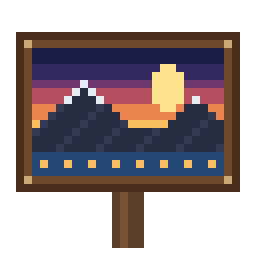

<h1 align="center">SignLink</h1>

  <b>Pictures, pixel art and glyph art on Valheim signs, and everyone sees them without a mod.</b> 
  A client-side BepInEx mod for Valheim.

  
  
  
  
  
  

  <a href="https://github.com/chestercs/valheim-signlink-mod/wiki"><b>Wiki</b></a> ·
  <a href="https://github.com/chestercs/valheim-signlink-mod/blob/main/docs/art-library.md"><b>Art showcase</b></a> ·
  <a href="https://github.com/chestercs/valheim-signlink-mod/blob/main/mod/package/README.md"><b>Player guide</b></a> ·
  <a href="https://github.com/chestercs/valheim-signlink-mod/blob/main/docs/limits.md">Limits</a> ·
  <a href="https://github.com/chestercs/valheim-signlink-mod/blob/main/docs/signart.md">Sign-art toolkit</a> ·
  <a href="https://github.com/chestercs/valheim-signlink-mod/blob/main/mod/CHANGELOG.md">Changelog</a>

  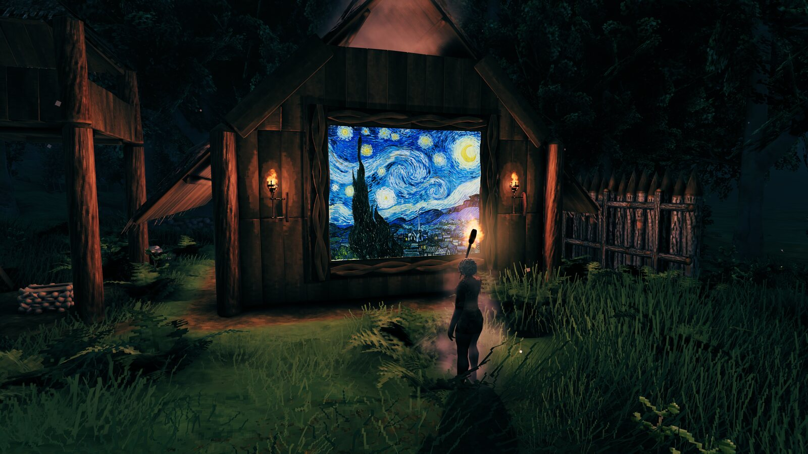

---

A Valheim sign can hold a lot more than "Wood" or "Metals". SignLink lets you put a real picture on it: your own photo,
a famous painting, a pixel-art animal that blinks and wags its tail, or a neat coloured label for the chest room. You
pick it, size it in metres, stand it on a wall or lay it on the floor, and put it up.

What goes on the sign is ordinary sign text, saved in your world like any other sign. That means:

- **Your friends see it without the mod.** Only the player who makes the picture needs SignLink.
- **The server needs nothing.** No server plugin, nothing to configure.
- **It stays if you uninstall.** The pictures remain as normal signs.

> **Version 1.1.0.** Get it on **[Thunderstore](https://thunderstore.io/c/valheim/p/PetyusPolisz/SignLink/)**
> (r2modman, Thunderstore Mod Manager), **[Nexus Mods](https://www.nexusmods.com/valheim/mods/4453)** (Vortex or by
> hand) or from [Releases](https://github.com/chestercs/valheim-signlink-mod/releases). See [Install](#install).

## What you can make

| | |
|---|---|
| 🖼️ **Your pictures** | Drop a PNG, JPG or GIF into a folder and pick it in game. Six famous paintings and a galloping horse GIF come with the mod, so you can try it right away. You choose how detailed it is and how many metres it covers, and a phone photo comes in the right way up. |
| 🧱 **Big pictures** | One sign shows up to 50 000 pixels. For more, SignLink stacks copies of the sign a fraction of a millimetre apart, and the picture still looks like one flat, seamless piece (up to about a million pixels in single player). |
| 🫥 **Transparency** | The see-through parts of a PNG stay empty, so a cut-out shape sits right on the wall with no box around it. Half-transparent edges stay soft. |
| 🐉 **Ready-made art** | **204 pieces, 150 of them animated.** Glyph art drawn with the game's runes and symbols (Eikthyr, The Elder, Yggdrasil, a dragon ship, Mjolnir...), pixel art (the cat and its friends, a boar family, necks, hens and chicks, wolves, bears, moose, seals, sea serpents, trolls, a campfire, a longship on the waves) and kitchen icons for your chest labels. [See them all](https://github.com/chestercs/valheim-signlink-mod/blob/main/docs/art-library.md). |
| 🔤 **Labels and text** | Coloured text, plus one-click templates: a coloured block to paint a wall or a floor, a label, a symbol (runes, arrows, frames, emoji), a two-colour pattern, or a QR code that phones can read. |
| 💡 **Glowing or lit** | A picture can glow in its own colours day and night, or take the light of the scene like normal sign text. |
| 📐 **Any angle** | Stand it on a wall, lay it face up as a floor mosaic or face down as a ceiling fresco, tilt it on an easel, turn it any way you like. |
| 🎞️ **Moving pictures** | The animated art pieces move for every SignLink player, all in step. Your own GIFs move for everyone who has the GIF file. Players without the mod see the first frame. |
| ✏️ **Change it later** | Select the sign again and everything you set is still there: the picture, its size, its place. You can edit a friend's picture too. *Copy* and *Paste* move a piece to another sign, animation and all. |
| 🌍 **Language support** | Game default (follows your game's language), English, Magyar, 简体中文, Русский. |
| 🎨 **Two looks** | Classic (dark wood and gold) or Nordic (slate and amber), both in the game's own font. |

### In the world

<table>
  <tr>
    <td width="50%">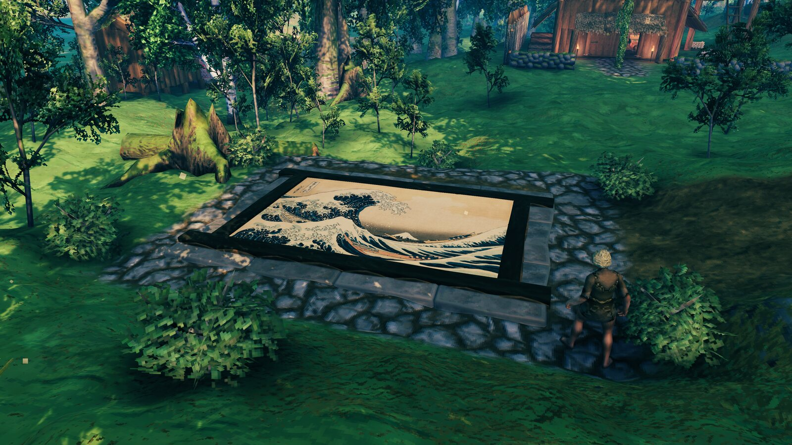 <b>Floor mural.</b> A sign laid face up, framed with beams.</td>
    <td width="50%">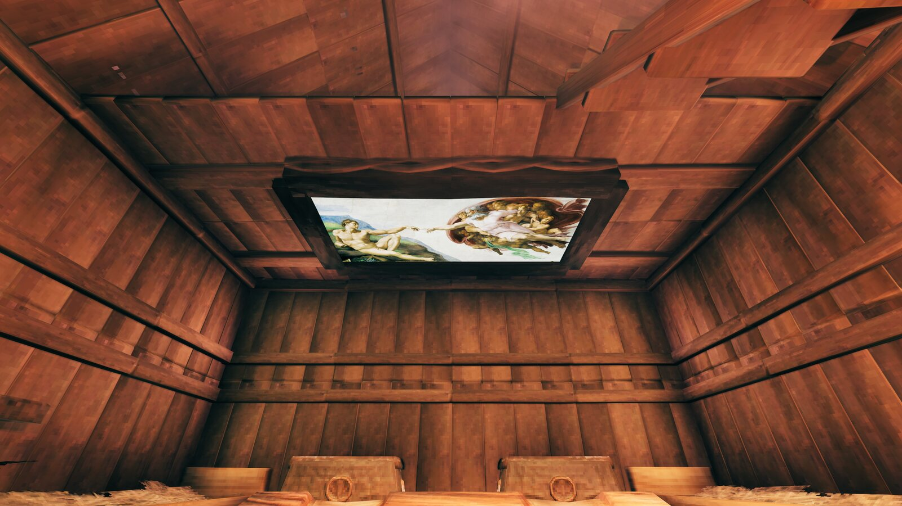 <b>Ceiling fresco.</b> A sign face down, seen from below.</td>
  </tr>
  <tr>
    <td>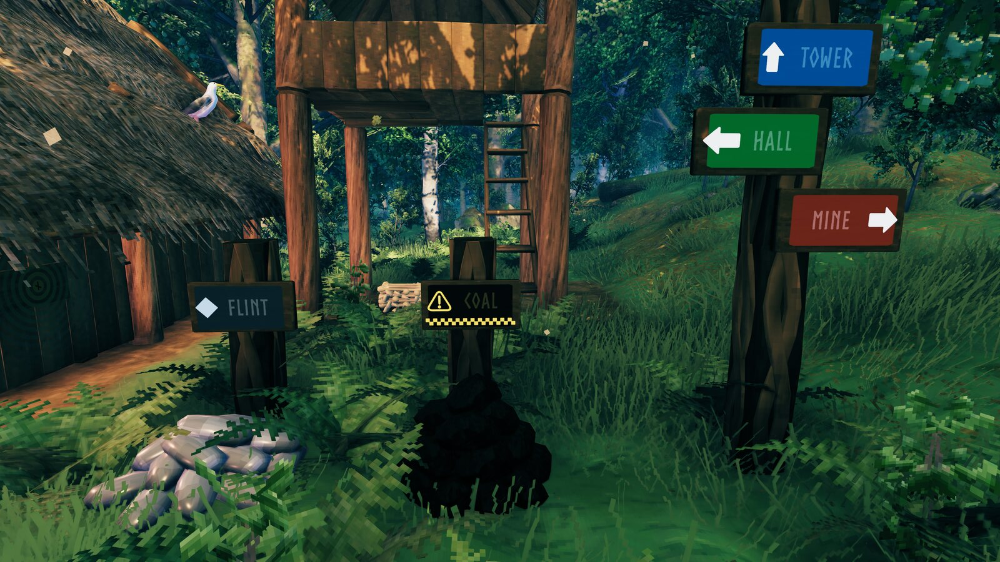 <b>Signposts and labels,</b> made with the text templates.</td>
    <td>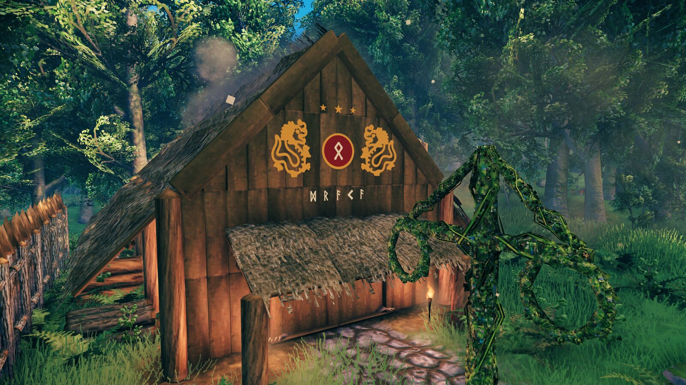 <b>Glyph art.</b> Runes and emblems drawn with the game's own glyphs.</td>
  </tr>
  <tr>
    <td>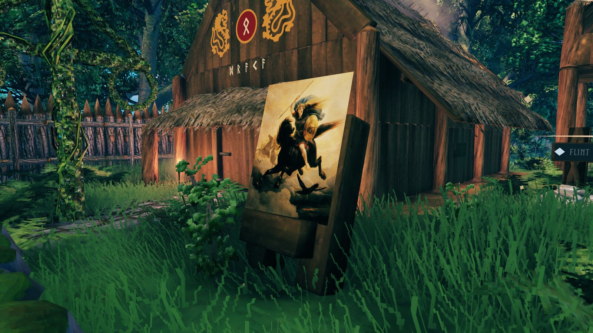 <b>Tilted.</b> A painting leaning back on an easel.</td>
    <td>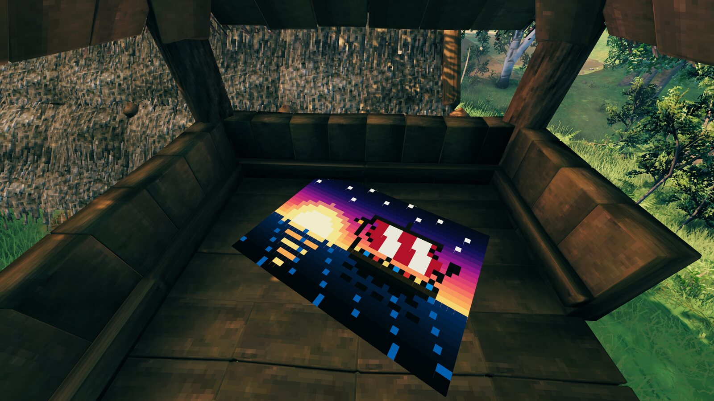 <b>Turned.</b> A pixel-art rug laid down at an angle.</td>
  </tr>
  <tr>
    <td>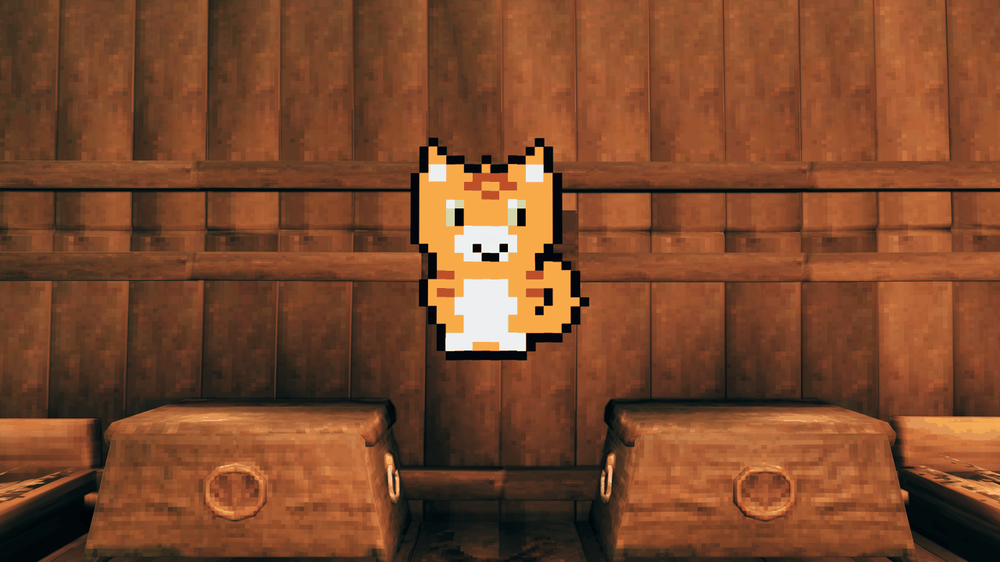 <b>Animated pixel art.</b> The built-in cat blinks and waves its tail.</td>
    <td>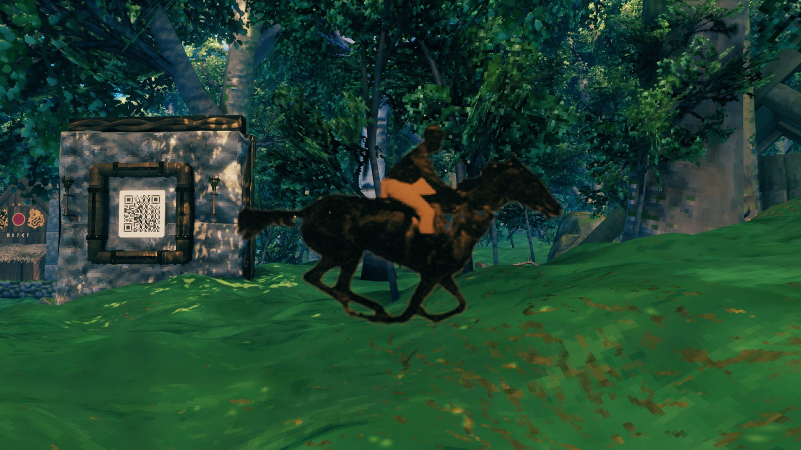 <b>Transparency.</b> A cut-out PNG gallops across the meadow: no box, no board, the sign hidden in the ground.</td>
  </tr>
  <tr>
    <td colspan="2">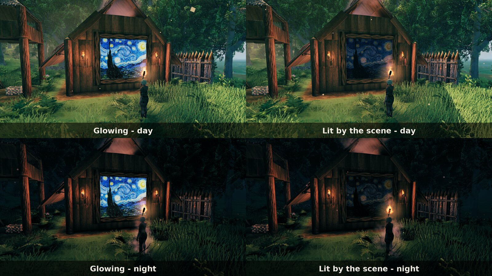 <b>Glowing or lit by the scene,</b> by day and by night.</td>
  </tr>
  <tr>
    <td colspan="2">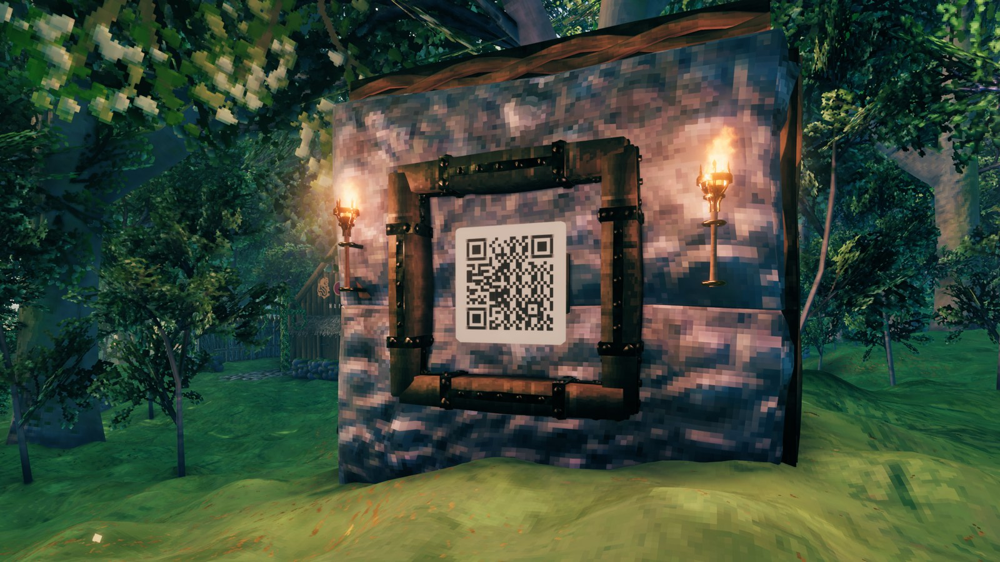 <b>QR code.</b> A link your phone can read, framed on a stone wall at sunset.</td>
  </tr>
</table>

## How it works in game

Build a sign where you want the picture, then press **Page Up** (or type `/signlink` in the chat). The window takes
you through three steps:

1. **1 Sign:** press *Select sign* and click your sign, or pick it from *Signs nearby*.
2. **2 Content:** choose an art piece or one of your pictures, or write a text. You see it on the sign straight away
   (only you, for now), and the *Summary* tells you how big it is and, on a server, whether it fits.
3. **3 Place:** set its size and place, stand it up, lay it down or tilt it. A highlight in the world shows where it
   goes: green where it will show, red where a wall or a floor would hide it. Press the button at the bottom and it's
   up for everyone. Until then nothing changes, and *Undo changes* throws your edits away.

Every slider also takes a typed number, **Shift + mouse wheel** moves it in fine steps, and the arrow keys nudge the
sign itself. You can walk around with the window open, and hold the **right mouse button** to look around.

  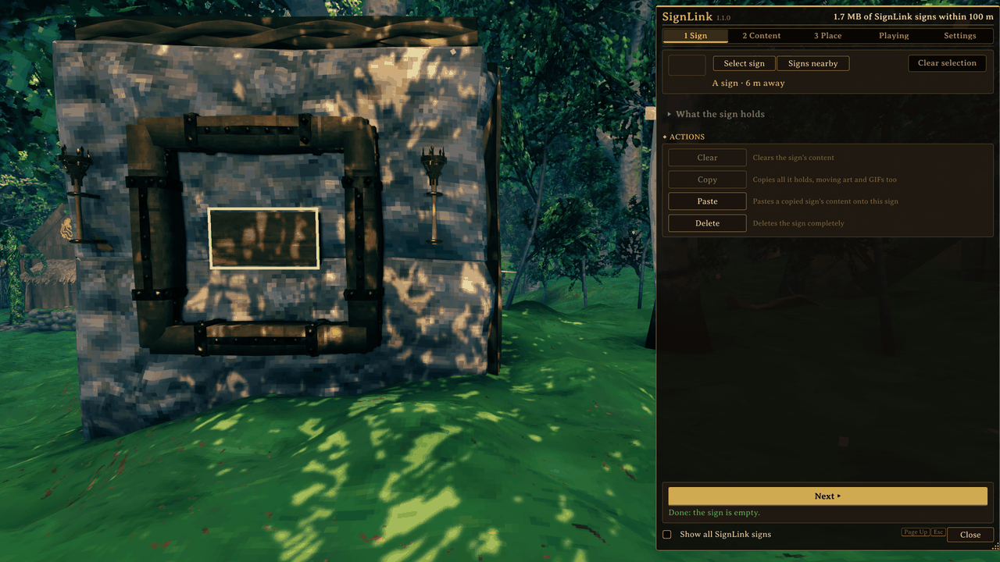

<table>
  <tr>
    <td width="33%">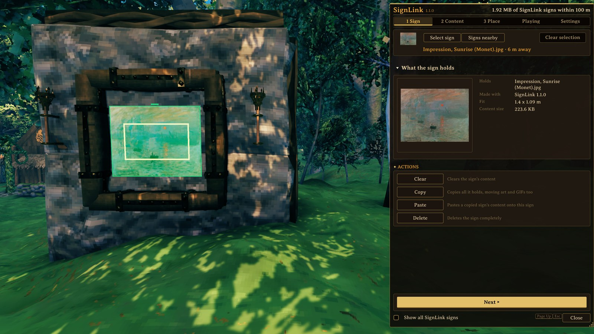 <b>1 Sign:</b> what the sign holds; Clear, Copy, Paste and Delete.</td>
    <td width="33%">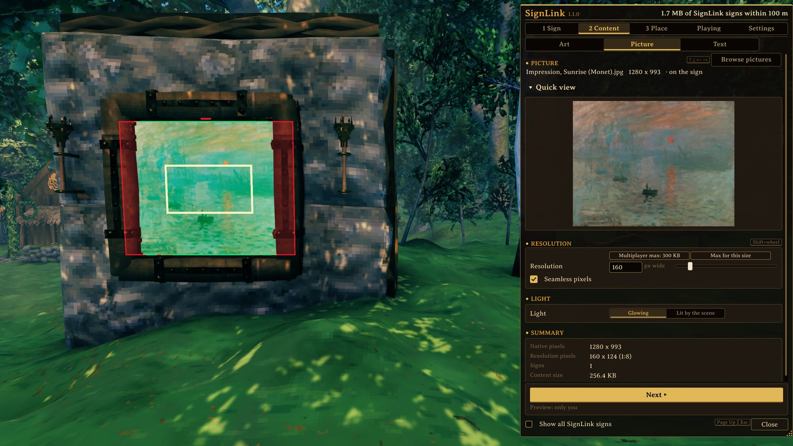 <b>2 Content:</b> the picture, its resolution, its light and the Summary.</td>
    <td width="33%">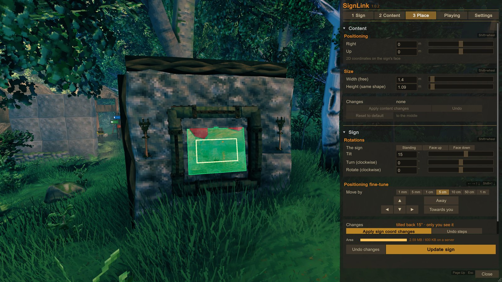 <b>3 Place:</b> size, place and tilt, with the highlight in the world.</td>
  </tr>
  <tr>
    <td>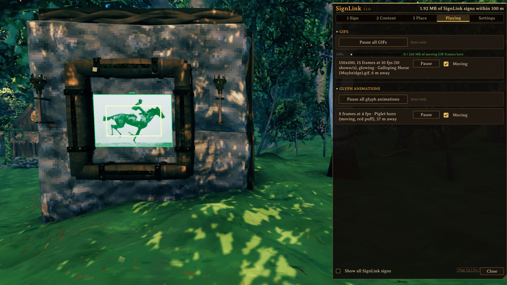 <b>Playing:</b> the moving pictures around you, each with Pause.</td>
    <td>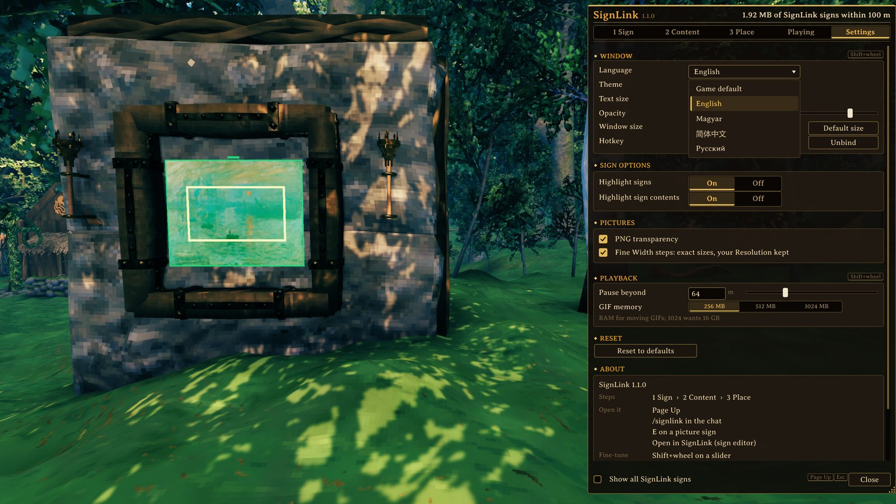 <b>Settings:</b> language, look, text size, hotkey and more.</td>
    <td></td>
  </tr>
</table>

## Settings

Everything is on the window's *Settings* tab, and changes take effect at once:

- **Window:** language, look (Classic or Nordic), text size, how see-through the window is, its size, and the key
  that opens it (Page Up; click it to choose another).
- **Sign options:** whether signs and the place a picture goes are outlined in the world while the window is open.
- **Pictures:** keep a PNG's see-through parts empty, and fine size steps for the Width.
- **Playback:** how far away moving pictures keep playing, and how much memory moving GIFs may use (256, 512 or
  1024 MB).
- **Reset to defaults** puts everything back.

## Multiplayer, done carefully

Every player who walks up to a picture has to download it first, and the buildings around it wait in the same queue.
So on a server SignLink keeps pictures light:

- **At most 300 KB on one sign** and **600 KB for all SignLink signs within 100 m**, everyone's together. The *Area*
  bar at the bottom of the window shows how full the spot is, and the *Summary* tells you what a picture costs before
  you put it up. *Multiplayer max* picks the most detail that fits.
- **Wards are respected.** Building and editing follow the game's own rules.
- **Single player has no limits at all**, and no Area bar.

Why these numbers, and what the game itself allows, is in
[what a sign can hold](https://github.com/chestercs/valheim-signlink-mod/blob/main/docs/limits.md).

### What 300 KB looks like

In single player a big picture stacks several copies of the sign for more detail. On a server one sign has to do the
job, so the same picture gets fewer, bigger pixels. Each sheet below shows the same scene from the same camera:
single player on the left, the 300 KB version on the right, the whole scene on top and a close-up below.

  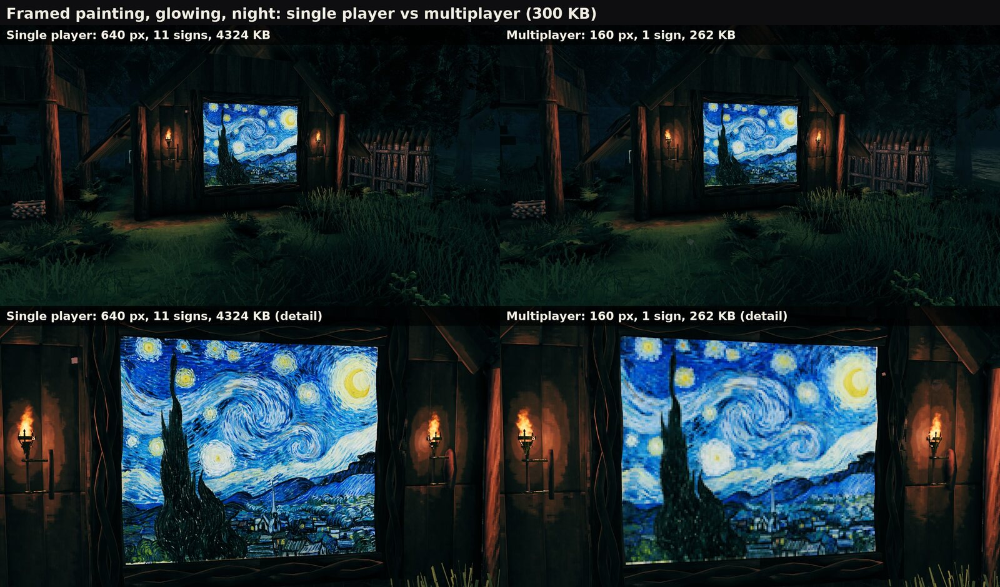
   <b>Framed painting, 4 m, glowing, at night.</b> Single player: 640 px, 11 signs, 4324 KB. Multiplayer: 160 px, 1 sign, 262 KB.

From a few steps away you can hardly tell them apart; up close, the multiplayer one turns into a mosaic. Small
pictures look exactly the same in both: the labels, the glyph art, the pixel-art cat and the window screenshots above
are all multiplayer-sized already.

<b>More comparisons</b>: floor, ceiling, easel, light

 

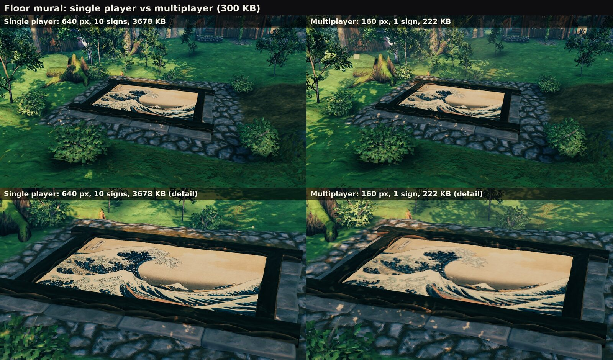
<b>Floor mural, 6 m.</b> Single player: 640 px, 10 signs, 3678 KB. Multiplayer: 160 px, 1 sign, 222 KB.
  

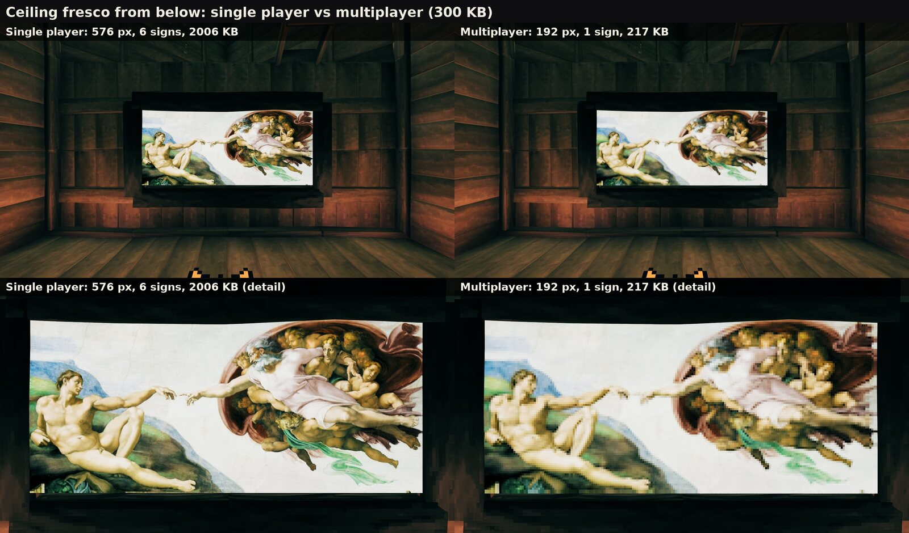
<b>Ceiling fresco, 3.6 m.</b> Single player: 576 px, 6 signs, 2006 KB. Multiplayer: 192 px, 1 sign, 217 KB.
  

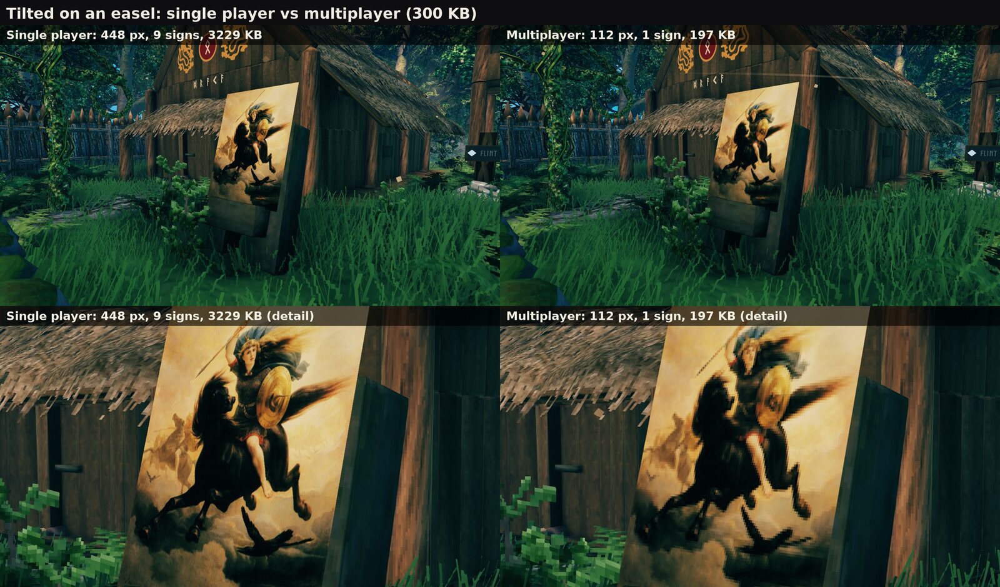
<b>Tilted on an easel, 1.4 m.</b> Single player: 448 px, 9 signs, 3229 KB. Multiplayer: 112 px, 1 sign, 197 KB.
  

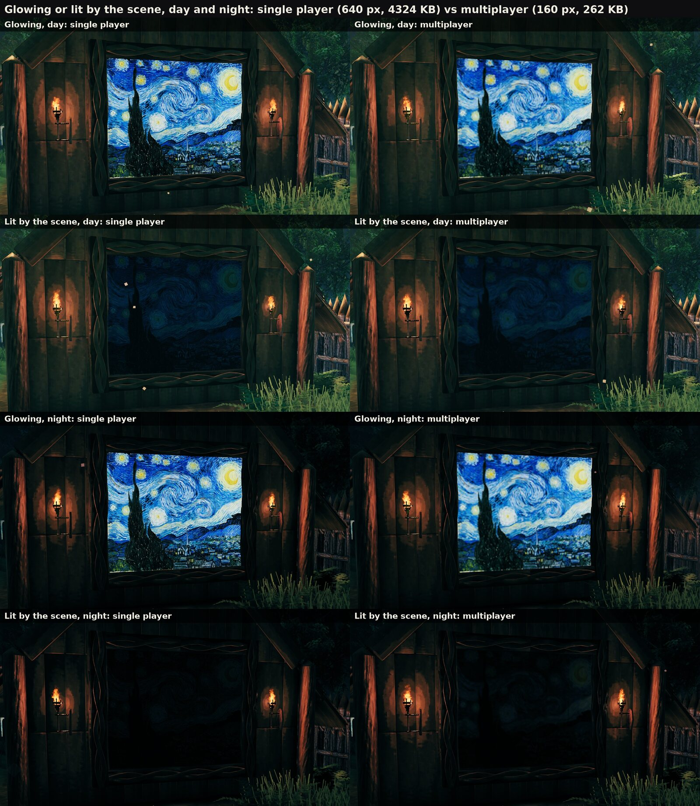
<b>Glowing or lit by the scene, by day and by night.</b> Single player: 640 px, 4324 KB. Multiplayer: 160 px, 262 KB.
Lit by the scene, the one-sign picture comes out a little brighter than the stack of eleven.

The multiplayer versions keep the width of the original and take the most detail that stays under 294 KB, which is
what *Multiplayer max* aims for. Pixel sizes come in fixed steps, so the next step up often no longer fits: the
Valkyrie at 149 px would be 349 KB, so it is 112 px at 197 KB.

The area limit matters more than the sign limit: two pictures this size fill one spot. On a server, plan a gallery as
a few big pieces and many small ones.

  <a href="https://github.com/chestercs/valheim-signlink-mod/blob/main/docs/art-library.md">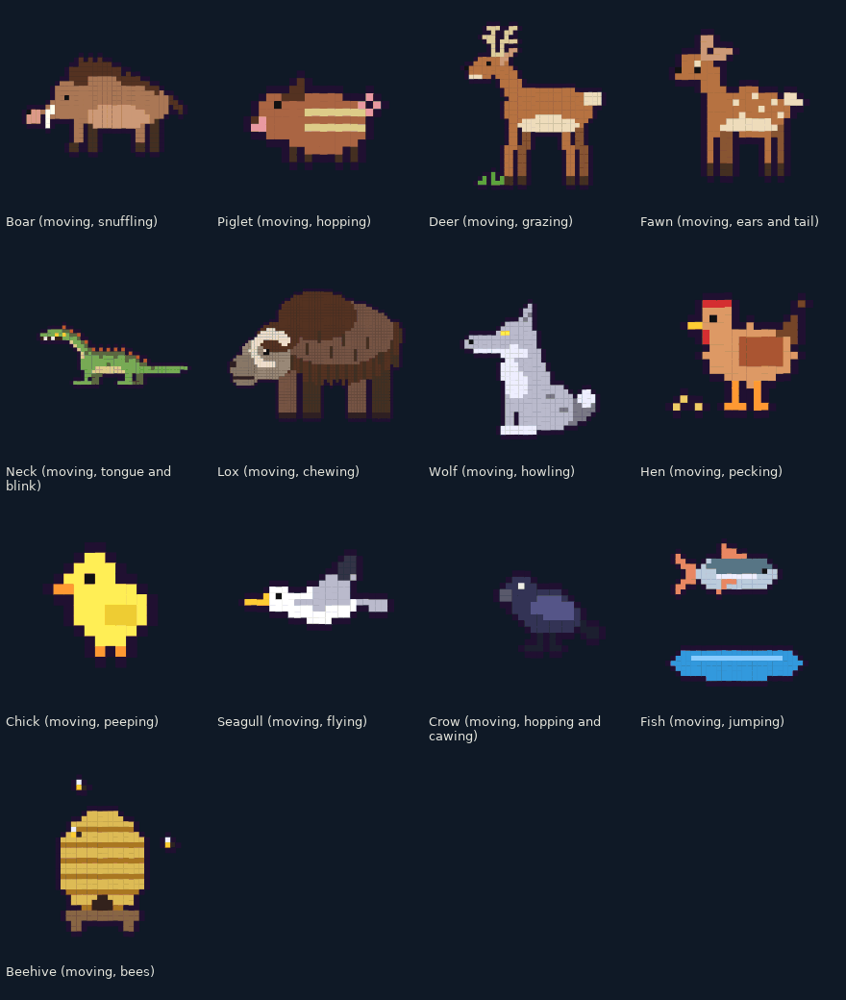</a>
  <a href="https://github.com/chestercs/valheim-signlink-mod/blob/main/docs/art-library.md">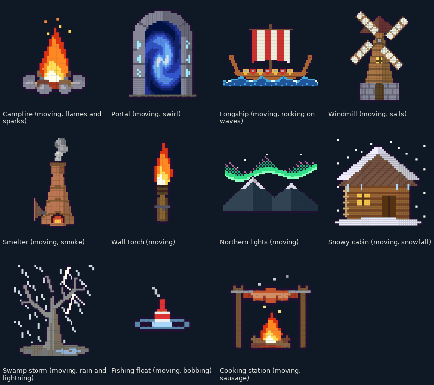</a>

  <b>204 ready-made art pieces come with the mod, and 150 of them are animated.</b> 
  🎞️ <a href="https://github.com/chestercs/valheim-signlink-mod/blob/main/docs/art-library.md"><b>See them all in the art showcase</b></a>

## Limits

SignLink stays inside what the game itself can do. The measured numbers are in
[what a sign can hold](https://github.com/chestercs/valheim-signlink-mod/blob/main/docs/limits.md) and
[how sign text renders](https://github.com/chestercs/valheim-signlink-mod/blob/main/docs/sign-rendering.md).

- **One sign shows at most 50 000 pixels.** Bigger pictures use stacked copies of the sign; on a server the size
  limits above decide how much detail fits.
- **A single-player world moved to a server keeps its big signs.** The limits are checked when you put something on a
  sign in a shared world, so a single-player world can hold bigger pictures. Moved to a server later, arriving players
  wait for them, and a sign over 512 KiB cannot be sent at all.
- **Big pictures take a moment to appear** when a player walks up: the download (about 150 KB/s on a server), then
  roughly 13 µs per pixel while the game builds the text.
- **GIFs move only where the file is.** Their frames are not saved in the world, so a GIF moves on the computers that
  have it in their images folder; everyone else sees its first frame.
- **Very long GIFs.** A GIF can have up to 5 000 frames (about 720 frames at 1920 x 1080). All moving GIFs share the
  GIF memory (256 MB; 512 or 1024 MB in Settings › Playback if your PC has the RAM). A GIF too long for it plays every
  second or third frame at the same speed, and one too big to move at all goes up as a still picture. The *Moving* row
  on 2 Content tells you which before you put it up.
- **The game's own sign editor cuts long text.** A player without SignLink who presses E on a picture sign and then
  Enter cuts it to 50 characters (Escape leaves it alone). Their game also slows down while they look at a picture
  sign's board up close. With SignLink, E opens SignLink instead and the hover shows one short line. Tip: hide the sign
  in a wall or the ground with only its picture showing (3 Place slides the picture along the sign), and there is
  nothing left to aim at.
- **A sign is still a building piece.** It needs support: a sign left floating breaks, and a ceiling picture's sign has
  to touch the beam or floor it hangs from.
- **A picture lies on its sign's face.** Anything in front of that face, such as the beams of a log wall, shows
  through it. The red part of the highlight warns you before you put it up.
- **Signs take the scene's light by default.** In the shade a label is dark; set it to *Glowing* to read it day and
  night. Tip: turn **Bloom** off in the game's graphics settings: glowing pictures look much sharper without it.
- **Keyboard and mouse only.** No controller support.
- **Client-side only.** A dedicated server does not need it.

## Install

**With a mod manager (recommended):** find **SignLink** in r2modman or the Thunderstore Mod Manager and install it,
or press *Install with Mod Manager* on [its Thunderstore page](https://thunderstore.io/c/valheim/p/PetyusPolisz/SignLink/).
BepInExPack Valheim comes with it.

**With Vortex:** *Mod Manager Download* on [the Nexus Mods page](https://www.nexusmods.com/valheim/mods/4453).

**By hand:** install [BepInExPack Valheim](https://thunderstore.io/c/valheim/p/denikson/BepInExPack_Valheim/), then
unpack `SignLink-1.1.0-nexus.zip` (from Nexus Mods or [Releases](https://github.com/chestercs/valheim-signlink-mod/releases))
into the Valheim folder. The mod ends up in `BepInEx/plugins/SignLink/`.

Your pictures go into `SignLink/images` in the game's data folder, next to your worlds (on Windows
`%USERPROFILE%\AppData\LocalLow\IronGate\Valheim\SignLink\images`); the *Open folder* button takes you there.
Folders inside it work too: the Picture list shows them (→ opens one, ← goes back up). A sign remembers its picture's
folder, so friends who want your GIF to move should put the file in the same folder of their own.

All settings are on the window's *Settings* tab (see [Settings](#settings)); the file is `BepInEx/config/PetyusPolisz.SignLink.cfg`.

**Uninstall:** remove it in the mod manager, or delete `BepInEx/plugins/SignLink/`. Your pictures stay as ordinary
signs. If you like, also delete the `SignLink` folder in the game's data folder (your images), `BepInEx/cache/SignLink/`
(thumbnails) and `BepInEx/config/PetyusPolisz.SignLink.cfg`.

## Coming next

- **A reworked text editor.** The Text tab's editor and its templates, made simpler to use.

## For developers and tinkerers

This repository is also the workshop SignLink grew out of:

- **[The sign-art toolkit](https://github.com/chestercs/valheim-signlink-mod/blob/main/docs/signart.md):** a model of
  how the game lays out sign text, the game's own glyph outlines, a renderer and checker, a browser simulator, and art
  you can build by hand, one glyph per sign, every command short enough to type into a vanilla sign.
- **[How sign text renders](https://github.com/chestercs/valheim-signlink-mod/blob/main/docs/sign-rendering.md)** and
  **[what a sign can hold](https://github.com/chestercs/valheim-signlink-mod/blob/main/docs/limits.md):** the measured
  facts behind the mod.
- **[The art showcase](https://github.com/chestercs/valheim-signlink-mod/blob/main/docs/art-library.md):** every
  built-in piece, rendered from the very sign texts the mod ships.
- **[The mod's internals](https://github.com/chestercs/valheim-signlink-mod/blob/main/mod/README.md)** and its
  [changelog](https://github.com/chestercs/valheim-signlink-mod/blob/main/mod/CHANGELOG.md).

Everything builds and runs in Docker (`./sign.sh`); nothing needs installing on the host.

## Credits

SignLink is made by **ChesTeRcs** (team PetyusPolisz) for a friends' Valheim server. It was written with Claude
(Anthropic's AI) under their direction and tested in their worlds. The code is MIT licensed ([LICENSE](LICENSE)); the art
library (the glyph and pixel art pieces) is CC BY 4.0 ([LICENSE-ART](LICENSE-ART)): playing with the pieces, and
screenshots or videos of them, need no credit; sharing the pieces themselves, in another mod or an art pack, does.

The paintings and the moving GIF that come with SignLink (the paintings appear in the screenshots) are in the public
domain, from Wikimedia Commons:
[The Starry Night](https://commons.wikimedia.org/wiki/File:Van_Gogh_-_Starry_Night_-_Google_Art_Project.jpg)
(Vincent van Gogh, 1889),
[The Great Wave off Kanagawa](https://commons.wikimedia.org/wiki/File:Tsunami_by_hokusai_19th_century.jpg)
(Katsushika Hokusai, c. 1831),
[The Creation of Adam](https://commons.wikimedia.org/wiki/File:Michelangelo_-_Creation_of_Adam_(cropped).jpg)
(Michelangelo, c. 1512),
[Valkyrien](https://commons.wikimedia.org/wiki/File:Peter_Nicolai_Arbo_-_Valkyrjen_-_Nasjonalmuseet_-_NG.M.00259.jpg)
(Peter Nicolai Arbo, 1869),
[The Wild Hunt of Odin](https://commons.wikimedia.org/wiki/File:Peter_Nicolai_Arbo_-_The_wild_Hunt_of_Odin_-_NG.M.00258_-_National_Museum_of_Art,_Architecture_and_Design.jpg)
(Peter Nicolai Arbo, 1872),
[Impression, Sunrise](https://commons.wikimedia.org/wiki/File:Monet_-_Impression,_Sunrise.jpg) (Claude Monet, 1872) and the
[galloping horse](https://commons.wikimedia.org/wiki/File:Muybridge_race_horse_animated.gif) (Eadweard Muybridge, 1887;
the animation by Waugsberg, 2006, Public Domain Mark).

If you like SignLink, you can [buy me a coffee](https://buymeacoffee.com/chestercs).

Valheim is a trademark of Iron Gate AB. SignLink is a fan-made mod and is not affiliated with Iron Gate or Coffee
Stain.
