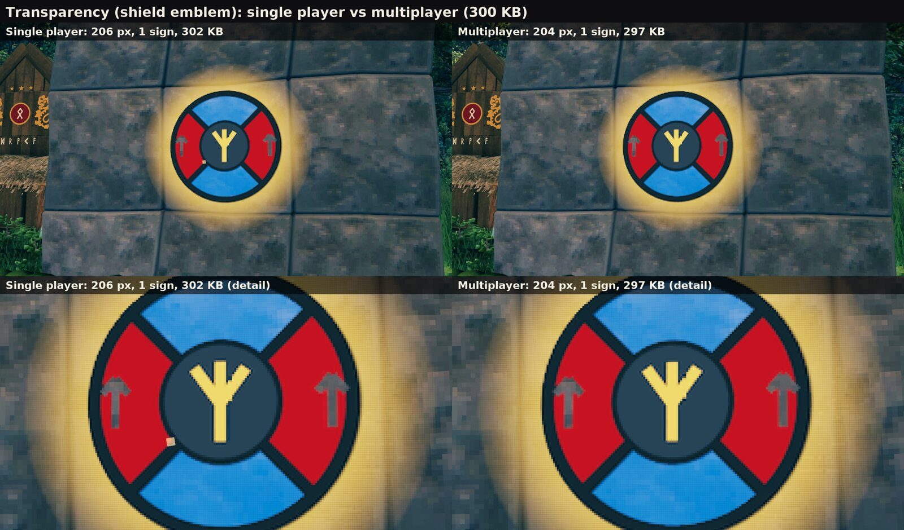

  

<h1 align="center">SignLink</h1>

  <b>Pictures, pixel art and glyph art on Valheim signs, and everyone sees them without a mod.</b> 
  A client-side BepInEx mod for Valheim.

  
  
  
  
  
  

  <a href="https://github.com/chestercs/valheim-signlink-mod/wiki"><b>Wiki</b></a> ·
  <a href="docs/art-library.md"><b>Art showcase</b></a> ·
  <a href="mod/package/README.md"><b>Player guide</b></a> ·
  <a href="docs/limits.md">Limits</a> ·
  <a href="docs/signart.md">Sign-art toolkit</a> ·
  <a href="mod/CHANGELOG.md">Changelog</a>

  

---

Valheim signs take rich text, so a single sign can hold far more than a name for your chest room. SignLink makes that
easy. Pick a photo, a piece of glyph art or a coloured label, size it in metres, tilt it onto a floor or a ceiling, and
put it on. The result is ordinary sign text, saved in the world like any other sign:

- **Players without the mod see it.** Only the player who makes the picture needs SignLink.
- **The server needs nothing.** No server plugin, no config sync, nothing to install for your friends.
- **Remove the mod and it stays.** The pictures remain as normal signs.

> **Version 1.0.3.** Get it on **[Thunderstore](https://thunderstore.io/c/valheim/p/PetyusPolisz/SignLink/)**
> (r2modman, Thunderstore Mod Manager), **[Nexus Mods](https://www.nexusmods.com/valheim/mods/4453)** (Vortex or by
> hand) or from [Releases](https://github.com/chestercs/valheim-signlink-mod/releases). See [Install](#install).

## What you can make

| | |
|---|---|
| 🖼️ **Pictures** | Drop a PNG, JPG or GIF into a folder and pick it in game; six famous paintings and a galloping horse (a moving GIF) come with the mod to start with. Choose how many pixels wide it is and how many metres it covers. A phone photo comes in the right way up. |
| 🧱 **Big pictures** | One sign shows up to 50 000 pixels. A bigger picture spreads over copies of the sign stacked a fraction of a millimetre apart, so it still looks like one flat, seamless picture (up to about a million pixels in single player). |
| 🫥 **Transparency** | The see-through parts of a PNG stay empty and cost nothing. Half-transparent parts stay half transparent. The sign's own board shows through them, so keep the part over the board solid. |
| 🐉 **Ready-made art** | **204 pieces in the Art tab, 150 of them animated:** glyph art drawn with runes and symbols (Eikthyr, The Elder, Yggdrasil, a dragon ship, Mjolnir and more) and pixel art (the cat and its friends, a boar family, necks, hens and chicks, forest animals, bears, wolves and moose, seals, fish and sea serpents, trolls, a campfire, a longship on the waves), and kitchen icons for chest labels. See them all in [the art showcase](docs/art-library.md). |
| 🔤 **Text with templates** | Coloured text, plus one-click pieces: a coloured block to paint a wall or a floor, a label, a symbol from a palette (runes, arrows, frames, emoji), a two-colour pattern, a QR code that phones read. |
| 💡 **Glowing or lit** | A picture glows in its own colours day and night, or takes the scene's light like normal sign text. |
| 📐 **Any pose** | Stand a sign up, lay it face up for a floor mural, or face down for a ceiling. Tilt it, turn it, and move and resize what it holds along its face. |
| 🎞️ **Moving pictures** | Saved animations play for every SignLink player on a shared clock. A GIF plays over its picture for everyone who has the GIF file. Players without the mod see the first frame. |
| ✏️ **Edit later** | Select a SignLink sign and the window shows what it was made with: change the size, the place or the picture, and press *Update content*. Another player's picture can be edited too, read back from the sign itself. *Copy* and *Paste* carry a piece to another sign, a moving one moving. |

### In the world

<table>
  <tr>
    <td width="50%"> <b>Floor mural.</b> A sign laid face up, framed with beams.</td>
    <td width="50%"> <b>Ceiling fresco.</b> A sign face down, read from below.</td>
  </tr>
  <tr>
    <td> <b>Signposts and labels.</b> Block, Label, Symbol and Pattern templates.</td>
    <td> <b>Glyph art.</b> Runes and emblems drawn with the game's own glyphs.</td>
  </tr>
  <tr>
    <td> <b>Tilted.</b> A painting leaning back 15° on an easel.</td>
    <td> <b>Turned.</b> A pixel-art rug laid down and turned 30°.</td>
  </tr>
  <tr>
    <td> <b>Animated pixel art.</b> The built-in cat blinks and waves its tail.</td>
    <td> <b>Transparency.</b> A PNG emblem on stone: the halo is half transparent, the arrows are cut out.</td>
  </tr>
  <tr>
    <td colspan="2"> <b>Glowing or lit by the scene,</b> by day and by night.</td>
  </tr>
  <tr>
    <td colspan="2"> <b>QR code.</b> The QR template: a link phones read, framed on a stone wall at sunset.</td>
  </tr>
</table>

## How it works in game

Build a sign where the picture should go, then press **PageUp** (or type `/signlink` in the chat). The window walks
you through three steps:

1. **Sign:** click a sign, use *Pick in view*, or choose one from *Signs nearby*.
2. **Content:** pick a built-in piece, pick a picture, or write a text. A live preview shows it on the sign, for you
   only, together with what it costs.
3. **Place:** two groups, *Content* (its place and size) and *Sign* (how the sign stands, tilts and turns, and fine
   steps to move it). A highlight in the world shows where it will go: green where it will show, red where a wall or
   a floor would hide it. Then press the button at the bottom: it says what changes, *Update content*, *Update sign*
   or both. Nothing goes on the sign before that, and *Undo changes* drops everything not applied yet.

Fine-tuning is built in: every slider takes a typed value, **Shift + mouse wheel** moves a slider by a fine step, and
the arrow keys nudge the sign itself. You can walk, run and jump with the window open. The full walkthrough, every
setting and its default are in the [player guide](mod/package/README.md).

  

<table>
  <tr>
    <td width="33%"> <b>1 Sign:</b> what the sign holds, what it costs, whether it fits a server.</td>
    <td width="33%"> <b>2 Content:</b> the picture, its resolution (Max for a server), light and cost.</td>
    <td width="33%"> <b>3 Place:</b> the Content and Sign groups; a tilt shown in the world, green where it shows and red where it hides, before the button puts it on.</td>
  </tr>
</table>

## Multiplayer, done carefully

A picture is data that every player near it has to download, and the buildings around it wait behind it. SignLink
keeps a shared world playable:

- **At most 300 KB on one sign** and **600 KB for all SignLink signs within 100 m**, everyone's together. A bar in
  the window shows how full the area is, and the window tells you the cost and the download wait before you place
  anything.
- Every sign stays well under the 512 KiB a sign can carry over the network.
- **Wards are respected.** Building and editing follow the game's own rules.
- Single player has none of these limits.

Why these numbers, and what the game itself allows, is in [what a sign can hold](docs/limits.md).

### What 300 KB looks like

Big pictures in single player stack several copies of the sign for more detail. In multiplayer one sign has to do it,
so the same picture gets fewer, bigger pixels. Each sheet below shows the same scene from the same camera, one shot
after the other: single player on the left, the 300 KB multiplayer version on the right, the whole scene on top and a
close-up below.

  
   <b>Framed painting, 4 m, glowing, at night.</b> Single player: 640 px, 11 signs, 4324 KB. Multiplayer: 160 px, 1 sign, 262 KB.

From a few steps away the two are hard to tell apart; up close, the multiplayer one is a mosaic. Small pictures cost
far less than 300 KB and look exactly the same in both: the labels, glyph art, the pixel-art cat and the window
screenshots above are all multiplayer-sized already.

<b>More comparisons</b>: floor, ceiling, easel, transparency, light

 

<b>Floor mural, 6 m.</b> Single player: 640 px, 10 signs, 3678 KB. Multiplayer: 160 px, 1 sign, 222 KB.
  

<b>Ceiling fresco, 3.6 m.</b> Single player: 576 px, 6 signs, 2006 KB. Multiplayer: 192 px, 1 sign, 217 KB.
  

<b>Tilted on an easel, 1.4 m.</b> Single player: 448 px, 9 signs, 3229 KB. Multiplayer: 112 px, 1 sign, 197 KB.
  

<b>Transparency, 2.6 m.</b> Single player: 206 px, 302 KB. Multiplayer: 204 px, 297 KB. A picture near the limit loses
next to nothing.
  

<b>Glowing or lit by the scene, by day and by night.</b> Single player: 640 px, 4324 KB. Multiplayer: 160 px, 262 KB.
Lit by the scene, the one-sign picture comes out a little brighter than the stack of eleven.

How the multiplayer versions were made: the same width as the original, and the most detail that keeps the sign under
294 KB, which is what the window's *Max (multiplayer)* button aims for. Pixel sizes come in fixed steps, so the next step up often no
longer fits: the Valkyrie at 149 px would be 349 KB, so it is 112 px at 197 KB.

The area limit matters more than the sign limit. Two pictures this size fill the 600 KB of one spot, so on a server,
plan a gallery as a few big pieces and many small ones.

  
  

  <b>204 ready-made art pieces come with the mod, and 150 of them are animated.</b> 
  🎞️ <a href="docs/art-library.md"><b>See them all in the art showcase</b></a>

## Limits

SignLink stays inside what the game itself can do. It is honest about it (the measured numbers are in
[what a sign can hold](docs/limits.md) and [how sign text renders](docs/sign-rendering.md)):

- **A sign's pixel budget is fixed.** A sign shows at most 50 000 pixels. Bigger pictures use stacked copies of the
  sign, and in multiplayer the size limits above decide how much detail fits.
- **Big pictures take a moment to appear** when a player walks up: roughly 13 µs per pixel on every player's
  computer, after the download (at most about 150 KB/s on a server).
- **GIFs move only where the file is.** The frames are not saved in the world, so a GIF moves on the computers that
  have it in their `images` folder; everyone else sees its first frame.
- **How big a GIF can be.** A GIF reads with up to 5 000 frames and 1 500 million pixels in all (about 720 frames of
  1920 x 1080). To move, its frames are shrunk to at most twice the sign's pixels (and 1024 a side; SignLink 1.0.2); every moving GIF
  shares the GIF memory (256 MB; 512 or 1024 in Settings › Playback on a PC with the RAM), the same GIF on many signs
  counting once. A GIF whose frames at that size pass about four fifths of it (200 MB of 256) plays fewer of them (every second, third ...,
  at the same speed); one too big to move goes on as a still picture. The Moving row on 2 Content says which before
  you put it on. A GIF beside you takes the room of GIFs idle far away or paused, and one that waits for room starts
  the moment room frees.
- **The vanilla sign editor cuts long text.** A player without SignLink who presses E on a picture sign and then
  Enter cuts it to 50 characters. Escape leaves it alone. Such a player's game also slows down while the crosshair
  rests on a picture sign's board up close (the game reads the whole picture for its hover hint: about 150 ms a
  frame for a 222 KB picture). With SignLink, E opens SignLink instead, and looking at a
  picture sign shows one short line instead of its whole text. Tip: hide the
  sign in a wall or the ground with only its picture out (3 Place slides the picture along the sign): there is no
  sign to aim at, and players without SignLink do not see its post or its raw text.
- **A sign is still a building piece.** It needs support like any other: a sign left floating breaks. A ceiling
  picture's sign has to touch the beam or floor it hangs from.
- **A picture lies on its sign's face.** Whatever stands in front of that face, such as the beams of a log wall,
  shows through it. The red part of the highlight shows this before you place anything; build the sign clear of
  them.
- **Signs take the scene's light by default.** In the shade a label is dark; set it to *Glowing* to read it day and
  night.
- **Keyboard and mouse only.** No controller support.
- **Client-side only.** A dedicated server does not need it.

## Install

**With a mod manager (recommended):** find **SignLink** in r2modman or the Thunderstore Mod Manager and install it,
or press *Install with Mod Manager* on [its Thunderstore page](https://thunderstore.io/c/valheim/p/PetyusPolisz/SignLink/).
BepInExPack Valheim comes with it as a dependency.

**With Vortex:** *Mod Manager Download* on [the Nexus Mods page](https://www.nexusmods.com/valheim/mods/4453).

**By hand:** install [BepInExPack Valheim](https://thunderstore.io/c/valheim/p/denikson/BepInExPack_Valheim/), then
unpack `SignLink-1.0.3-nexus.zip` (from Nexus Mods or [Releases](https://github.com/chestercs/valheim-signlink-mod/releases))
into the Valheim folder: the mod goes to `BepInEx/plugins/SignLink/`.

Put your pictures into `SignLink/images` in the game's own data folder, next to your worlds (on Windows `%USERPROFILE%\AppData\LocalLow\IronGate\Valheim\SignLink\images`). The *Open folder* button in the window opens it. Folders inside
it work too: copy a whole folder in, and the Picture list shows it (→ opens a folder, ← goes back up). A sign remembers
its picture's folder, so friends want the file in the same folder of their own images folder.

All settings are in the window's *Settings* tab (the file is `BepInEx/config/PetyusPolisz.SignLink.cfg`). The full
player guide, every setting and its default, is in [`mod/package/README.md`](mod/package/README.md).

**Uninstall:** remove it in the mod manager, or delete `BepInEx/plugins/SignLink.dll`. The pictures stay as ordinary
signs. Optional: delete the `SignLink` folder in the game's data folder (your images), `BepInEx/cache/SignLink/`
(thumbnails) and `BepInEx/config/PetyusPolisz.SignLink.cfg`.

## Coming next

- **A glyph-art designer.** Compose glyph art layer by layer: runes, symbols and shapes from the game's own fonts, a colour palette, a live canvas preview of what the sign
  will show, then save it as a piece and place it from the window.
- **Art animations on the same player as GIFs.** Moving art pieces played locally from one module, smooth, with
  nothing extra stored in the world.

## For developers and tinkerers

This repository is also the workshop SignLink grew out of:

- **[The sign-art toolkit](docs/signart.md):** a model of how the game lays out sign text, the game's own glyph
  outlines, a renderer and checker, a browser simulator, and art concepts you can build by hand: one glyph per sign,
  every command short enough to type into a vanilla sign.
- **[How sign text renders](docs/sign-rendering.md)** and **[what a sign can hold](docs/limits.md):** the measured
  facts behind the mod.
- **[The art showcase](docs/art-library.md):** every built-in piece, rendered from the very sign texts the mod
  ships.
- **[The toolkit's developer API](docs/api.md):** how the toolkit writes art into a running game. It exists only in a
  developer build made from this source; released SignLink opens no port.
- **[The mod's internals](mod/README.md)** and its [changelog](mod/CHANGELOG.md).

Everything builds and runs in Docker (`./sign.sh`); nothing needs installing on the host.

## Credits

SignLink is made by **ChesTeRcs** (team PetyusPolisz) for a friends' Valheim server. It was written with Claude
(Anthropic's AI) under their direction and tested in their worlds. The code is MIT licensed ([LICENSE](LICENSE)); the art
library (the glyph and pixel art pieces) is CC BY 4.0 ([LICENSE-ART](LICENSE-ART)): playing with the pieces, and
screenshots or videos of them, need no credit; sharing the pieces themselves, in another mod or an art pack, does.

The paintings and the moving GIF that come with SignLink (the paintings appear in the screenshots) are in the public
domain, from Wikimedia Commons:
[The Starry Night](https://commons.wikimedia.org/wiki/File:Van_Gogh_-_Starry_Night_-_Google_Art_Project.jpg)
(Vincent van Gogh, 1889),
[The Great Wave off Kanagawa](https://commons.wikimedia.org/wiki/File:Tsunami_by_hokusai_19th_century.jpg)
(Katsushika Hokusai, c. 1831),
[The Creation of Adam](https://commons.wikimedia.org/wiki/File:Michelangelo_-_Creation_of_Adam_(cropped).jpg)
(Michelangelo, c. 1512),
[Valkyrien](https://commons.wikimedia.org/wiki/File:Peter_Nicolai_Arbo_-_Valkyrjen_-_Nasjonalmuseet_-_NG.M.00259.jpg)
(Peter Nicolai Arbo, 1869),
[The Wild Hunt of Odin](https://commons.wikimedia.org/wiki/File:Peter_Nicolai_Arbo_-_The_wild_Hunt_of_Odin_-_NG.M.00258_-_National_Museum_of_Art,_Architecture_and_Design.jpg)
(Peter Nicolai Arbo, 1872),
[Impression, Sunrise](https://commons.wikimedia.org/wiki/File:Monet_-_Impression,_Sunrise.jpg) (Claude Monet, 1872) and the
[galloping horse](https://commons.wikimedia.org/wiki/File:Muybridge_race_horse_animated.gif) (Eadweard Muybridge, 1887;
the animation by Waugsberg, 2006, Public Domain Mark).

If you like SignLink, you can [buy me a coffee](https://buymeacoffee.com/chestercs).

Valheim is a trademark of Iron Gate AB. SignLink is a fan-made mod and is not affiliated with Iron Gate or Coffee
Stain.
