# The art library

SignLink comes with ready-made art under *Art* on 2 Content: pick a piece, press *Update content* at the bottom of 3
Place, and it is on the sign. Every player sees it, with or without the mod. Animated pieces go on moving (switch *Moving* off for a still) and move
for SignLink players, and everyone else sees their first frame, so that frame is always a good picture on its own.

The pictures below are rendered from the exact sign texts the mod ships, outside the game.

The art library is licensed CC BY 4.0 ([LICENSE-ART](../LICENSE-ART)): use the pieces on your signs, and share
screenshots and videos of them, with no credit needed; credit SignLink when you share the pieces themselves.

- **Pixel art** is drawn at one scale, the cat's (5.6 cm a pixel), so the animals stand side by side at their true
  sizes. Almost all of it moves.
- **Glyph art** is drawn with the game's own runes and symbols. A piece is a few kilobytes on one sign and the copies
  stacked on it.
- **Kitchen icons** are one-metre labels for chests.

195 pieces join the classics (the dragon ship in glyph art and in pixel art, Eikthyr, Huginn and Muninn, Jormungandr,
Mjolnir, the dragon crest, the midnight light and the moon halo); the cat leads the cat's family and the fjord at dusk the
scenes. Every piece is at most 80 KB, so it fits a server's limits.

## The cat's family

A kitten with a ball of yarn, a black cat stretching, a calico asleep, a white cat washing, a Siamese out for a walk, a
Viking hound, a puppy, an old dog, a wolf cub, and the cat with its hound.

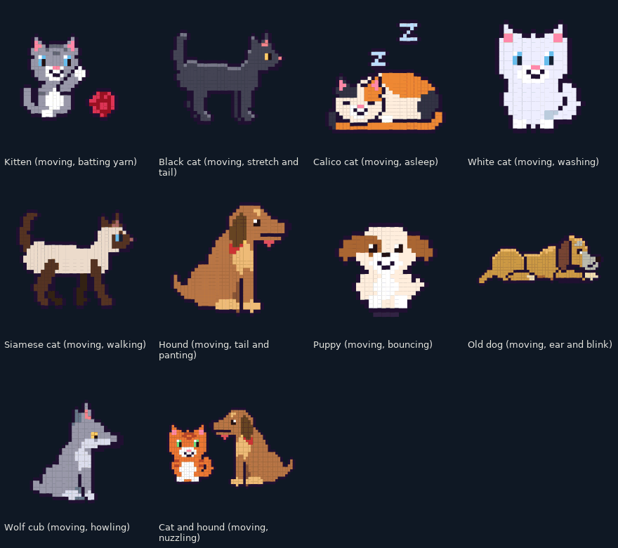

More cats: a kitten in a basket, a cat and a butterfly, kittens at play, a cat loaf, a cat with its fish, a cat in a
barrel, a cat asleep on a shield, a cat stalking a bird, a mother cat with kittens, the cat in a Viking helmet, a
yawning cat and a kitten in a mead mug.

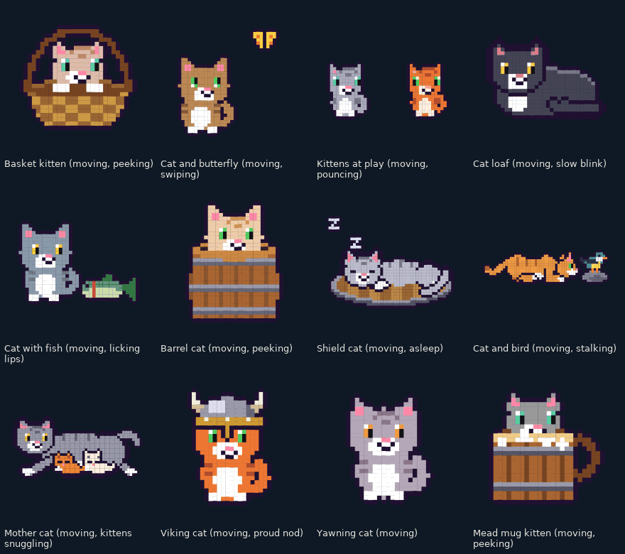

## The cat's friends

A sled dog, a dog with a bone, a puppy chasing its tail, and the cat with a piglet, a fawn, a raven, a hen and her
chicks, a neck and a lox; a piglet and a puppy at tug of war, a hound and a wolf cub howling, and a group photo.

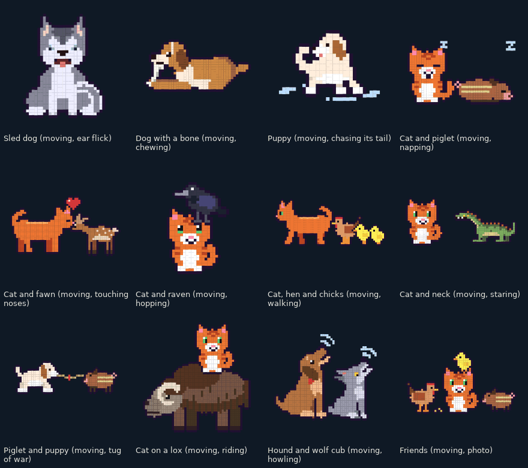

## Animals of Valheim

Boar, piglet, deer, fawn, neck, lox, wolf, hen, chick, seagull, crow, a leaping fish and a beehive.


### The boar family

A tame boar being petted, a charging boar, a boar backing away from a torch, a mother with piglets, a piglet born in a
red puff, piglets at play, a sleeping piglet, a boar at the trough, a muddy boar, a two-star boar, a piglet with a
carrot, a boar family on the move, a boar in a flower crown and a boar trophy.

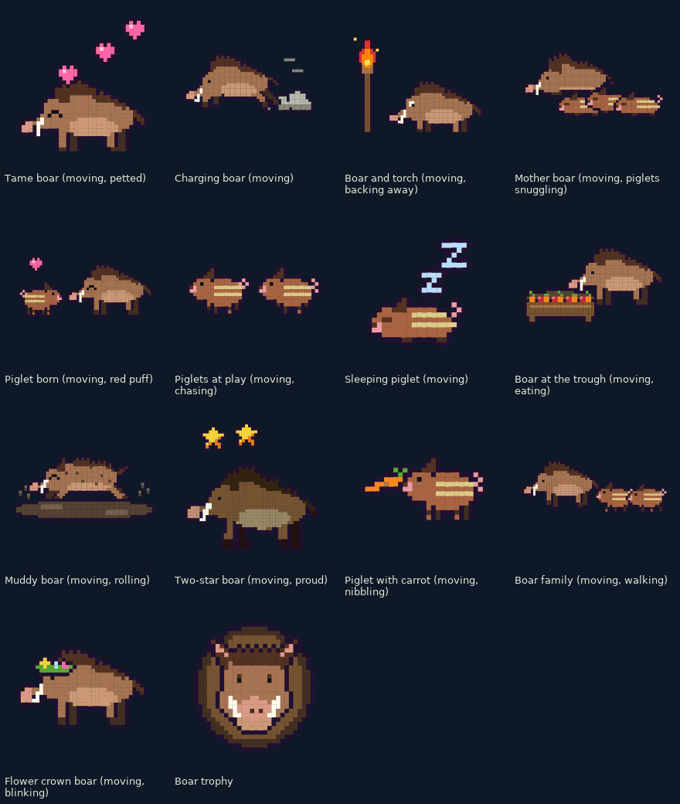

### The neck family

The neck, a long-necked shore lizard with a spiny crest: in the muck, in the rain, the three star levels, a bite,
sunbathing, hatching, catching a fly, swimming, asleep, poked by the cat, with a flower, and its tail on a spit.

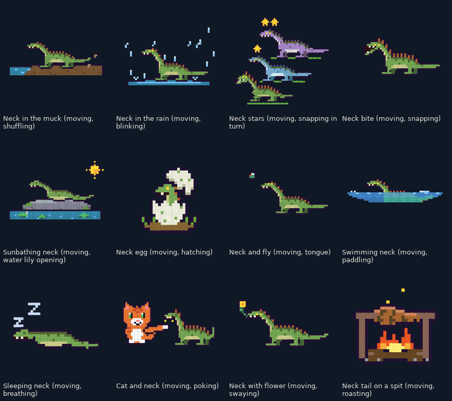

### Hens, chicks and eggs

A hen laying an egg, an egg hatching, a brooding hen, chicks pecking, a chick chasing a beetle, chicks under a hen's
wings, a basket of eggs, a fried egg, a chick asleep in its shell, a panicking hen, a Viking hen, the cat guarding the
eggs and a rune egg.

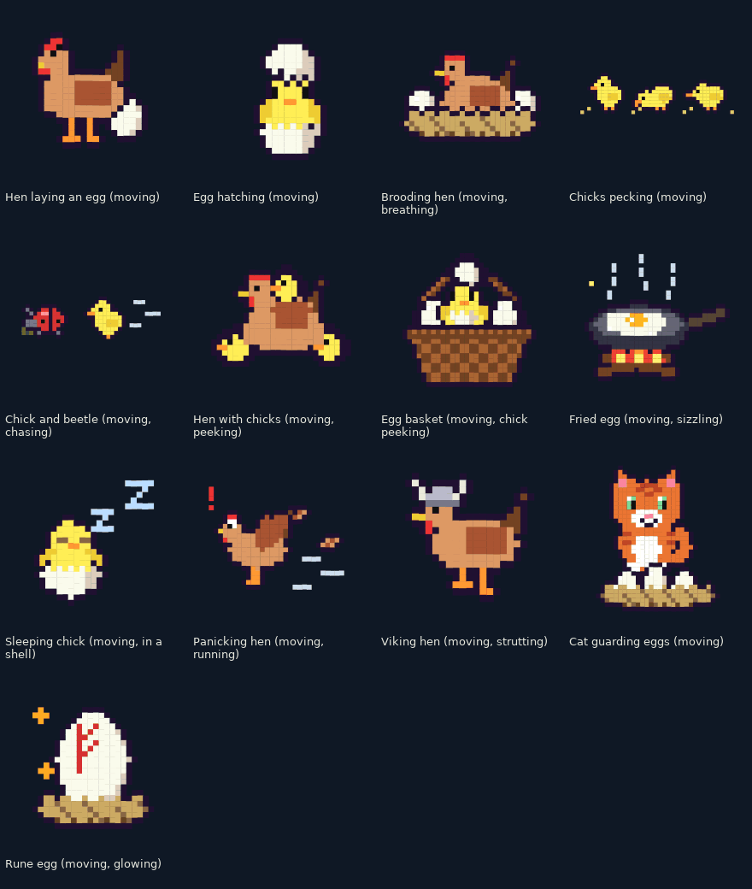

### Forest and farm

Fox, hare, owl, squirrel, hedgehog, frog, goat, pony, sheep, a duck and ducklings, bat, mouse, snail, butterfly, bear
cub, beaver and moose.

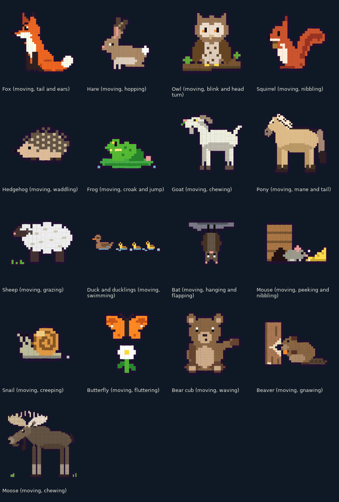

### Wild animals

A bull moose bellowing and wading, rabbits with a carrot and at their burrow, a brown bear walking, fishing and
scratching its back, wolves howling at the moon and trotting through snow, and a giraffe eating leaves.

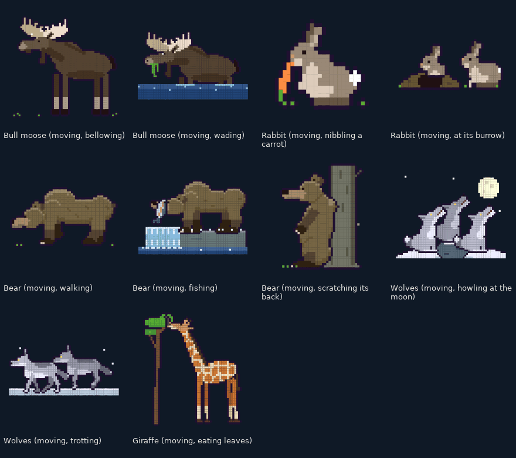

### Sea and rivers

A seal clapping and diving, a seal pup on the ice, a salmon leaping a waterfall, a perch, a pike snapping, a herring
shoal, a fish on a hook, the sea serpent in the waves and roaring, and a sea turtle.

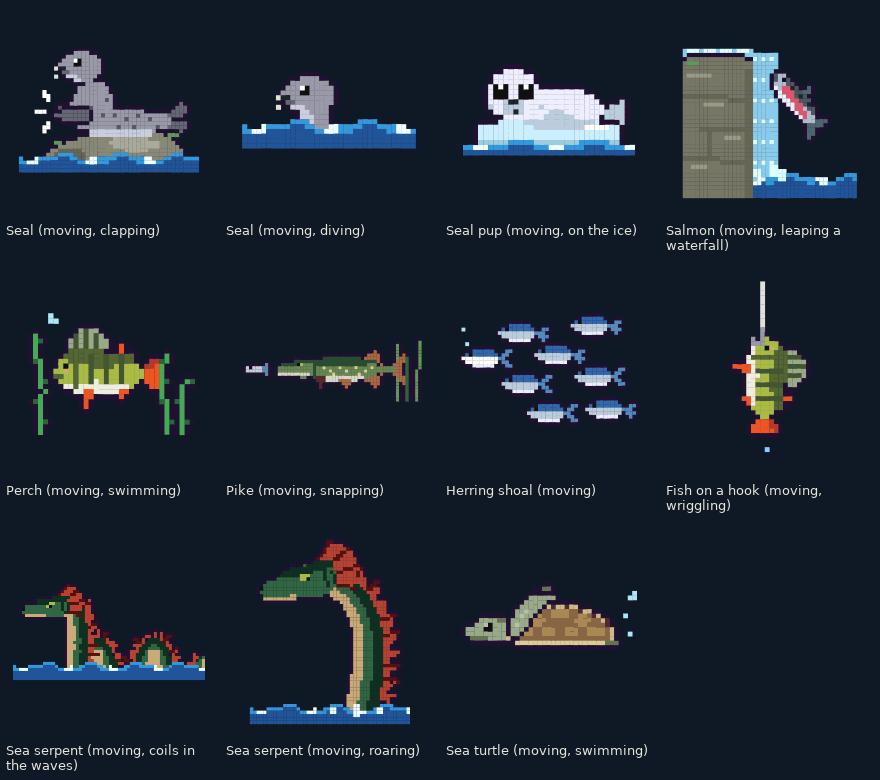

## Creatures

Greyling, greydwarf and greydwarf shaman, troll, skeleton, draugr, blob, leech, surtling, deathsquito, fuling and
drake. All but the draugr move.

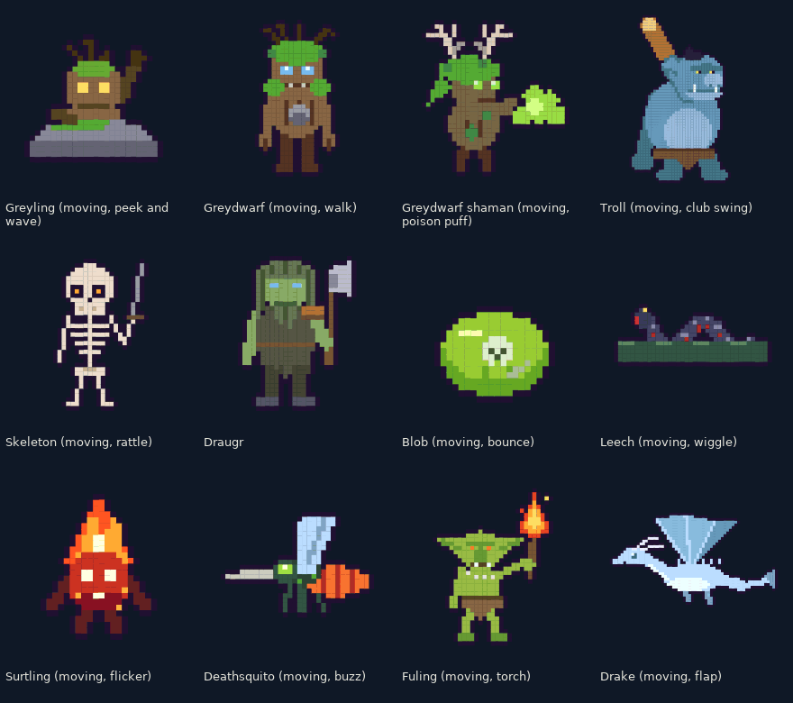

## Scenes

A campfire, a portal, a longship on the waves, a windmill, a smelter, a wall torch, northern lights, a snowy cabin, a
swamp storm, a fishing float and a cooking station.


## Kitchen icons

One-metre labels for the kitchen's chests, all on the same round plate: spices, vegetables, fruit and berries,
mushrooms, raw and cooked meat, sausages, fish, eggs, bread, grain and flour, honey, sweets, soup and stew, drinks,
cookware, knives and utensils, firewood, leftovers, salt and preserves, all food, a feast, and a fire, a cauldron and a
frying pan that move.

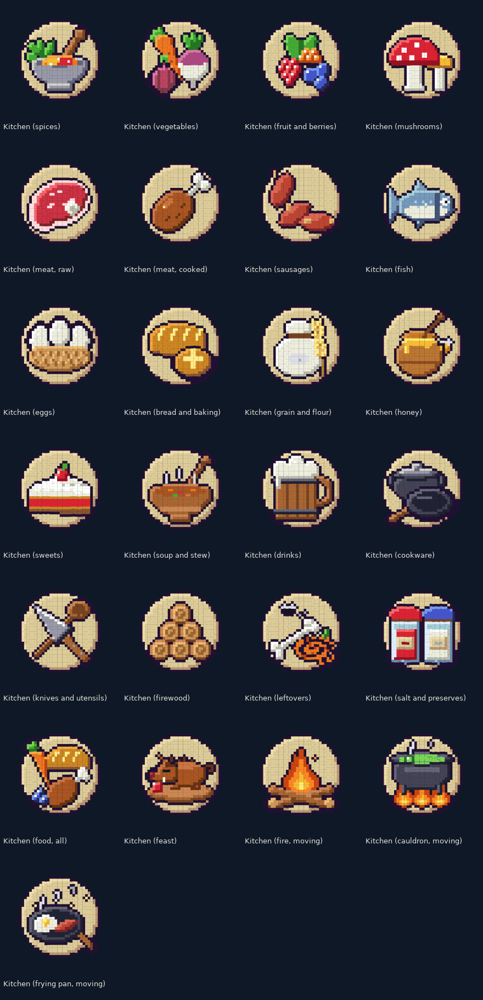

## Heroes and bosses (glyph art)

The Elder, Bonemass, Haldor, Hugin, a Viking warrior, a valkyrie, a troll face and a greydwarf shaman.

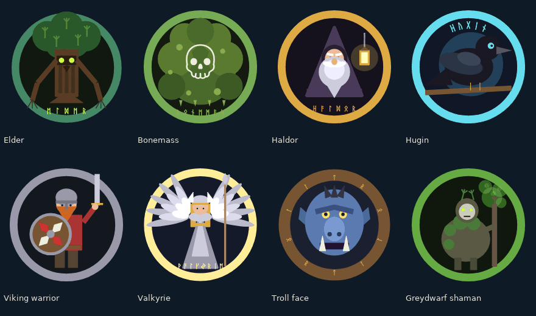

## The world (glyph art)

Yggdrasil, a portal (also animated), an anvil and hammer, a mead horn, crossed axes, a runestone, a longhouse, a burial
chamber, a cauldron, a clan banner, a rune compass and a fjord sunrise.

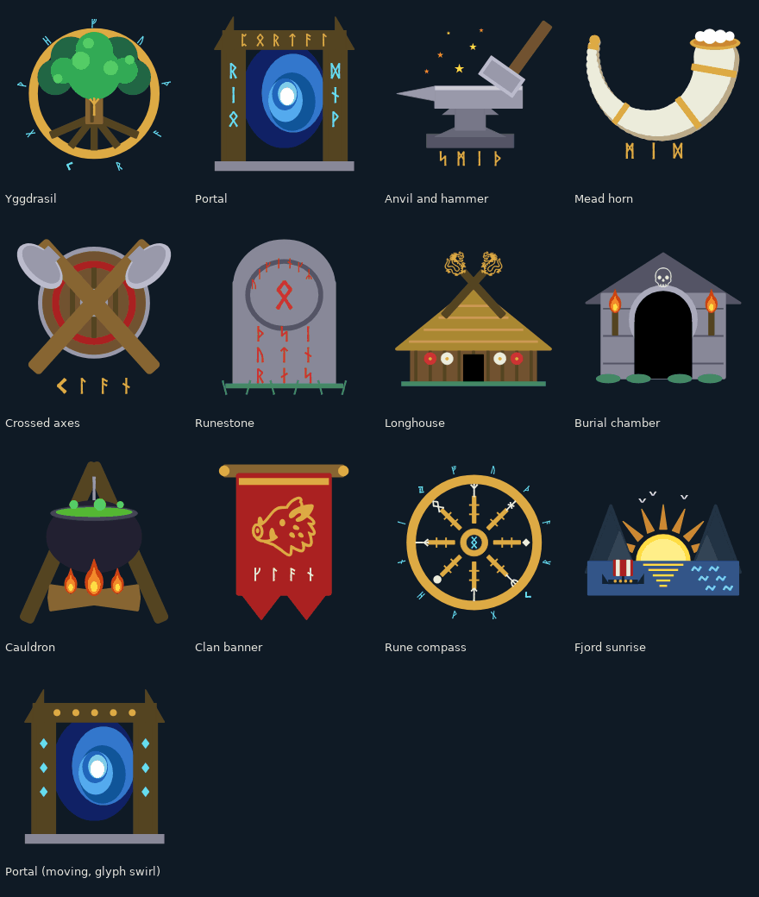

## Making more

Each theme is one file in `signart/concepts/lib_*.py`, built on `signart/artlib.py`:

```sh
./sign.sh py art_preview.py concepts.lib_pets                 # PNG, GIF and a frame strip of every piece, for review
./sign.sh py art_showcase.py out/showcase concepts.lib_pets   # the animated sheet above
./sign.sh art                                                 # everything into mod/SignLink/Art (embedded in the DLL)
```
